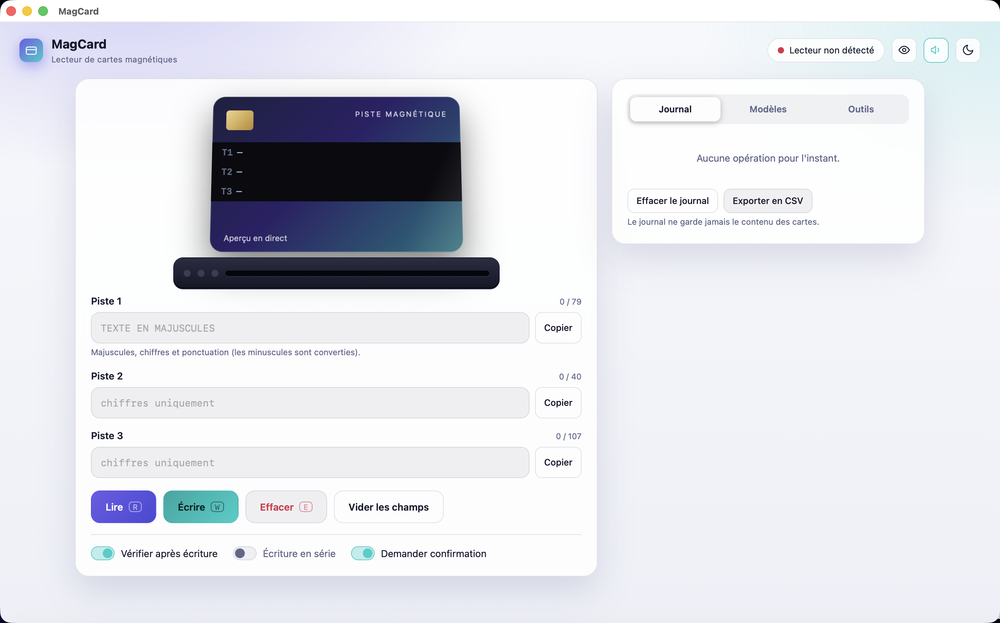

<p align="center">
  
</p>
<h1 align="center">MagCard</h1>
<p align="center">Read and write magnetic-stripe cards on a Mac, with an MSR605X reader.</p>
<p align="center">
  <a href="README.md">Français</a> ·
  
  
</p>

<p align="center"></p>

## What it does

MagCard drives an **MSR605X** (USB HID) reader from a real macOS application, with a simple interface:

- read and write all 3 tracks of a magnetic-stripe card;
- automatic verification after write;
- saved presets (reusable sets of values);
- an operation log (never the card contents) exportable to CSV;
- one-click copy to the clipboard to paste the value elsewhere;
- coercivity setting (hi-co / lo-co) and a reader LED test.

This project is the companion of [ChipCard](https://github.com/Wudstyz/ChipCard), which does the same for smart cards (PC/SC readers). The two are deliberately separate applications, each with its own name and icon, to keep things simple.

## Installation

1. Download the latest release from the [Releases](../../releases) tab (`.dmg` file).
2. Open the `.dmg`, drag **MagCard** into *Applications*.
3. First launch: the app is not notarized by Apple (no paid developer account for this small free project). macOS may refuse to open it on the first double-click — **right-click → Open**, then confirm. If that's not enough, run in Terminal:
   ```bash
   xattr -dr com.apple.quarantine "/Applications/MagCard.app"
   ```

Nothing else to install: no Python, no Homebrew, no Node — everything is bundled in the app.

## Getting started

1. Plug in the MSR605X reader over USB.
2. Launch MagCard: the top-right pill turns green once the reader is detected.
3. **Read** a card, or fill the **Track 1/2/3** fields and click **Write**.
4. Use **Copy** next to each track to paste the value into another field.

## Compatibility and known limitations

- Tested with an **MSR605X** reader (USB HID, VID/PID `0x0801`/`0x0003`) on **Apple Silicon Mac (arm64)**.
- Not tested on Intel Macs, nor on a second Mac besides the development machine.
- No hardware-free simulation mode yet: an MSR605X reader must be plugged in to try the app.
- The app is not notarized (see above).

## Building from source

```bash
git clone https://github.com/Wudstyz/MagCard.git
cd MagCard
./build_app.sh     # builds MagCard.app (downloads its dependencies into .venv/)
./make_dmg.sh      # builds MagCard.dmg from MagCard.app
```

## Code layout

- `app.py` / `app_common.py` — native window (pywebview) around the local server.
- `msr.py` — MSR605X USB HID protocol and a small local HTTP server for the UI.
- `web/index.html` — the UI (a single page, no external dependency).
- `build_assets/` — icon generation.

## Contributing

Suggestions and pull requests are welcome, especially for compatibility with other Macs or other readers in the same family.

## License

[MIT](LICENSE) — see also [THIRD_PARTY_NOTICES.md](THIRD_PARTY_NOTICES.md).
