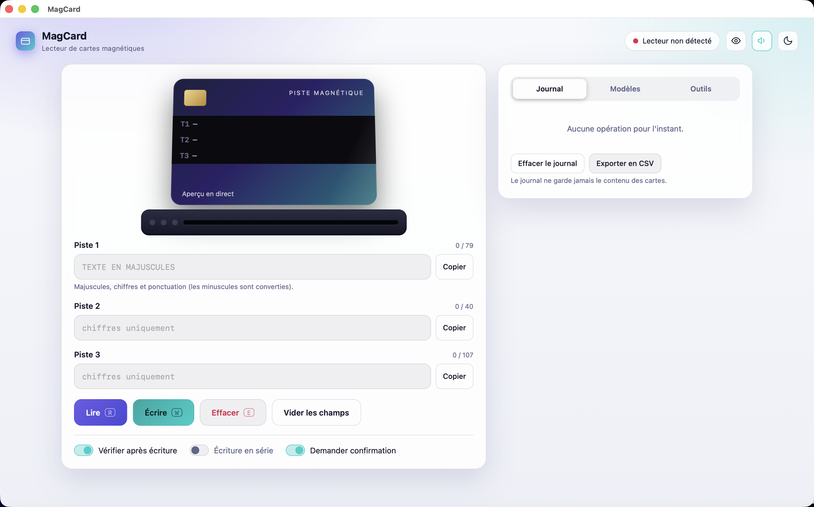

<p align="center">
  
</p>
<h1 align="center">MagCard</h1>
<p align="center">Lire et écrire des cartes à piste magnétique sur Mac, avec un lecteur MSR605X.</p>
<p align="center">
  <a href="README.en.md">English</a> ·
  
  
</p>

<p align="center"></p>

## Ce que ça fait

MagCard pilote un lecteur **MSR605X** (USB HID) depuis une vraie application macOS, avec une interface simple en français :

- lecture et écriture des 3 pistes d'une carte magnétique ;
- vérification automatique après écriture ;
- modèles enregistrés (jeux de valeurs réutilisables) ;
- journal des opérations (jamais le contenu des cartes) exportable en CSV ;
- copie en un clic vers le presse-papiers pour coller la valeur ailleurs ;
- réglage de la coercivité (hico / loco) et test des voyants du lecteur.

Ce projet est le compagnon de [ChipCard](https://github.com/Wudstyz/ChipCard), qui fait la même chose pour les cartes à puce (lecteurs PC/SC). Les deux sont volontairement deux applications séparées, chacune avec son propre nom et sa propre icône, pour rester simples.

## Installation

1. Télécharge la dernière version dans l'onglet [Releases](../../releases) (fichier `.dmg`).
2. Ouvre le `.dmg`, glisse **MagCard** dans *Applications*.
3. Premier lancement : l'application n'est pas notariée par Apple (pas de compte développeur payant pour ce petit projet gratuit). Au premier double-clic, macOS peut refuser de l'ouvrir — fais **clic droit → Ouvrir**, puis confirme. Si ça ne suffit pas, lance dans le Terminal :
   ```bash
   xattr -dr com.apple.quarantine "/Applications/MagCard.app"
   ```

Rien d'autre à installer : ni Python, ni Homebrew, ni Node — tout est embarqué dans l'application.

## Premiers pas

1. Branche le lecteur MSR605X en USB.
2. Lance MagCard : le bandeau en haut à droite passe au vert quand le lecteur est détecté.
3. **Lire** une carte, ou remplis les champs **Piste 1/2/3** et clique **Écrire**.
4. Utilise **Copier** à côté de chaque piste pour coller la valeur dans un autre champ.

## Compatibilité et limites connues

- Testé avec un lecteur **MSR605X** (USB HID, VID/PID `0x0801`/`0x0003`) sur **Mac Apple Silicon (arm64)**.
- Non testé sur Mac Intel, ni sur un deuxième Mac que celui du développement.
- Pas de mode de simulation sans matériel pour l'instant : il faut un lecteur MSR605X branché pour essayer l'application.
- L'application n'est pas notariée (voir ci-dessus).

## Construire depuis les sources

```bash
git clone https://github.com/Wudstyz/MagCard.git
cd MagCard
./build_app.sh     # construit MagCard.app (télécharge ses dépendances dans .venv/)
./make_dmg.sh      # construit MagCard.dmg à partir de MagCard.app
```

## Organisation du code

- `app.py` / `app_common.py` — fenêtre native (pywebview) autour du serveur local.
- `msr.py` — protocole USB HID du MSR605X et petit serveur HTTP local pour l'interface.
- `web/index.html` — interface (une seule page, sans dépendance externe).
- `build_assets/` — génération de l'icône.

## Contribuer

Les suggestions et pull requests sont bienvenues, en particulier pour la compatibilité avec d'autres Mac ou d'autres lecteurs de la même famille.

## Licence

[MIT](LICENSE) — voir aussi [THIRD_PARTY_NOTICES.md](THIRD_PARTY_NOTICES.md).
